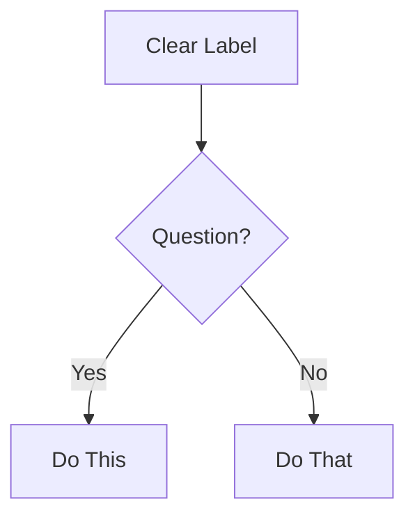

# Technical Documentation Standards for Arcwright

CommonMark standards, technical writing best practices, and style guide compliance — plus
audience analysis, the Diátaxis document-type framework, changelog/SemVer conventions, docs-as-code,
and reader testing.

## User Specified CRITICAL Rules - Supersedes General CRITICAL RULES

None

## General CRITICAL RULES

### Rule 1: CommonMark Strict Compliance

ALL documentation MUST follow CommonMark specification exactly. No exceptions.

### Rule 2: NO TIME ESTIMATES

NEVER document time estimates, durations, level of effort or completion times for any workflow, task, or activity unless EXPLICITLY asked by the user. This includes:

- NO Workflow execution time (e.g., "30-60 min", "2-8 hours")
- NO Task duration and level of effort estimates
- NO Reading time estimates
- NO Implementation time ranges
- NO Any temporal or capacity based measurements

**Instead:** Focus on workflow steps, dependencies, and outputs. Let users determine their own timelines and level of effort.

### CommonMark Essentials

**Headers:**

- Use ATX-style ONLY: `#` `##` `###` (NOT Setext underlines)
- Single space after `#`: `# Title` (NOT `#Title`)
- No trailing `#`: `# Title` (NOT `# Title #`)
- Hierarchical order: Don't skip levels (h1→h2→h3, not h1→h3)

**Code Blocks:**

- Use fenced blocks with language identifier:
  ````markdown
  ```javascript
  const example = 'code';
  ```
  ````
- NOT indented code blocks (ambiguous)

**Lists:**

- Consistent markers within list: all `-` or all `*` or all `+` (don't mix)
- Proper indentation for nested items (2 or 4 spaces, stay consistent)
- Blank line before/after list for clarity

**Links:**

- Inline: `[text](url)`
- Reference: `[text][ref]` then `[ref]: url` at bottom
- NO bare URLs without `<>` brackets

**Emphasis:**

- Italic: `*text*` or `_text_`
- Bold: `**text**` or `__text__`
- Consistent style within document

**Line Breaks:**

- Two spaces at end of line + newline, OR
- Blank line between paragraphs
- NO single line breaks (they're ignored)

## Mermaid Diagrams: Valid Syntax Required

**Critical Rules:**

1. Always specify diagram type first line
2. Use valid Mermaid v10+ syntax
3. Test syntax before outputting (mental validation)
4. Keep focused: 5-10 nodes ideal, max 15

**Diagram Type Selection:**

- **flowchart** - Process flows, decision trees, workflows
- **sequenceDiagram** - API interactions, message flows, time-based processes
- **classDiagram** - Object models, class relationships, system structure
- **erDiagram** - Database schemas, entity relationships
- **stateDiagram-v2** - State machines, lifecycle stages
- **gitGraph** - Branch strategies, version control flows

**Formatting:**

````markdown

````

## Audience & Purpose (Do This First)

Before writing a single line, establish — ask the user if unknown (3-5 concise numbered questions):

1. **Reader** — who reads this? (end user, integrating developer, contributor, operator, future-you)
2. **Prior knowledge** — what can you assume they already know? what must you not assume?
3. **Goal** — what is the reader trying to *accomplish* when they open this doc?
4. **Context of use** — read once start-to-finish, or scanned/searched under time pressure?
5. **Success** — what does "this doc worked" look like?

Audience drives everything downstream: document type, depth, vocabulary, and how much to explain.
Never start drafting until reader + goal are clear.

## Diátaxis: Choose the Document Type

Every documentation page serves **exactly one** of four purposes. Mixing them is the most common
documentation failure. Identify the quadrant first, then write to it — keep a single quadrant per
page (**single-quadrant purity**).

| Type | Serves | Reader is… | Answers | Form |
|------|--------|-----------|---------|------|
| **Tutorial** | Learning | a beginner being taught | "teach me by doing" | A guided lesson; guaranteed-to-work steps; no choices/options |
| **How-to guide** | A task | a user with a goal | "how do I accomplish X?" | Ordered steps for one real-world goal; assumes competence |
| **Reference** | Information | a user who needs facts | "what are the exact details?" | Dry, complete, consistent; describes the machinery (API/CLI/config) |
| **Explanation** | Understanding | a user who wants the *why* | "why does it work this way?" | Discursive; background, trade-offs, design rationale |

**Decision compass:**

- Practical + study (acquiring skill) → **Tutorial**
- Practical + work (applying skill) → **How-to**
- Theoretical + work (applying knowledge) → **Reference**
- Theoretical + study (acquiring knowledge) → **Explanation**

**Anti-patterns (single-quadrant violations):**

- A tutorial that stops to explain internals or list every option → move that to Explanation/Reference.
- A how-to that teaches concepts from scratch → link a tutorial instead.
- Reference padded with tutorials/opinions → keep it factual; move narrative out.
- Explanation crammed with step-by-step instructions → extract a how-to.

A README is a *router*, not a quadrant: it orients and links out to the four types.

## Style Guide Principles (Distilled)

Apply in this hierarchy:

1. **Project-specific guide** (if exists) - always ask first
2. **Arcwright conventions** (this document)
3. **Google Developer Docs style** (defaults below)
4. **CommonMark spec** (when in doubt)

### Core Writing Rules

**Task-Oriented Focus:**

- Write for user GOALS, not feature lists
- Start with WHY, then HOW
- Every doc answers: "What can I accomplish?"

**Clarity Principles:**

- Active voice: "Click the button" NOT "The button should be clicked"
- Present tense: "The function returns" NOT "The function will return"
- Direct language: "Use X for Y" NOT "X can be used for Y"
- Second person: "You configure" NOT "Users configure" or "One configures"

**Structure:**

- One idea per sentence
- One topic per paragraph
- Headings describe content accurately
- Examples follow explanations

**Accessibility:**

- Descriptive link text: "See the API reference" NOT "Click here"
- Alt text for diagrams: Describe what it shows
- Semantic heading hierarchy (don't skip levels)
- Tables have headers

## OpenAPI/API Documentation

**Required Elements:**

- Endpoint path and method
- Authentication requirements
- Request parameters (path, query, body) with types
- Request example (realistic, working)
- Response schema with types
- Response examples (success + common errors)
- Error codes and meanings

**Quality Standards:**

- OpenAPI 3.0+ specification compliance
- Complete schemas (no missing fields)
- Examples that actually work
- Clear error messages
- Security schemes documented

## Changelogs & Versioning

**Changelog** — follow [Keep a Changelog](https://keepachangelog.com): a human-readable
`CHANGELOG.md`, newest version first.

- Group entries under headings: **Added, Changed, Deprecated, Removed, Fixed, Security**.
- Keep an `## [Unreleased]` section at the top; move it under a version + date (`## [1.4.0] - 2026-06-28`) on release.
- Write for humans, not a `git log` dump — describe user-visible impact, not internal commits.

**Versioning** — follow [SemVer](https://semver.org) `MAJOR.MINOR.PATCH`:

- **MAJOR** — incompatible/breaking changes. **MINOR** — backward-compatible features. **PATCH** — backward-compatible fixes.
- A breaking change requires a MAJOR bump **and** a migration note (what broke, how to update).

**Changelog vs release notes:** the changelog is the complete, terse record; release notes are a
curated, narrative highlight of a release for end users. Don't conflate them.

## Docs as Code

Treat docs as source: same repo, same review, same CI.

- **Co-locate** docs with the code they describe; commit them in the **same PR** as the change. A
  feature isn't done until its docs are updated.
- **Review** doc diffs like code (correctness + clarity).
- **Lint/test** in CI: `markdownlint` (format), **Vale** (prose/style-guide), a link-checker, and —
  where possible — compile/run code samples so they can't rot.
- **Build & publish** from CI via a static-site generator (Docusaurus, MkDocs, Sphinx, Astro Starlight).
- **Version docs with the code** so the published docs match the released version.

## Reader Testing

Before declaring a doc done, validate it against a fresh reader:

- Spawn a **fresh sub-agent** with no prior context, give it only the doc + the reader's goal, and
  have it attempt the task or list every question it still has. Gaps it hits are your revisions.
- Confirm the doc still serves its single Diátaxis quadrant after edits (no drift).

## Documentation Types: Quick Reference

**README:**

- What (overview), Why (purpose), How (quick start)
- Installation, Usage, Contributing, License
- Under 500 lines (link to detailed docs)
- Final Polish include a Table of Contents

**API Reference:**

- Complete endpoint coverage
- Request/response examples
- Authentication details
- Error handling
- Rate limits if applicable

**User Guide:**

- Task-based sections (How to...)
- Step-by-step instructions
- Screenshots/diagrams where helpful
- Troubleshooting section

**Architecture Docs:**

- System overview diagram (Mermaid)
- Component descriptions
- Data flow
- Technology decisions (ADRs)
- Deployment architecture

**Developer Guide:**

- Setup/environment requirements
- Code organization
- Development workflow
- Testing approach
- Contribution guidelines

## Quality Checklist

Before finalizing ANY documentation:

- [ ] Audience + goal established before drafting
- [ ] Document type chosen (Diátaxis) and single-quadrant purity held
- [ ] CommonMark compliant (no violations)
- [ ] NO time estimates anywhere (Critical Rule 2)
- [ ] Headers in proper hierarchy
- [ ] All code blocks have language tags
- [ ] Links work and have descriptive text
- [ ] Mermaid diagrams render correctly
- [ ] Active voice, present tense
- [ ] Task-oriented (answers "how do I...")
- [ ] Examples are concrete and working
- [ ] Accessibility standards met
- [ ] Spelling/grammar checked
- [ ] Reads clearly at target skill level
- [ ] Changelog/SemVer updated if this ships a change (Added/Changed/Fixed; breaking → MAJOR + migration note)
- [ ] Reader-tested (fresh sub-agent attempts the task / lists open questions)

**Frontmatter:**
Use YAML frontmatter when appropriate, for example:

```yaml
---
title: Document Title
description: Brief description
author: Author name
date: YYYY-MM-DD
---
```